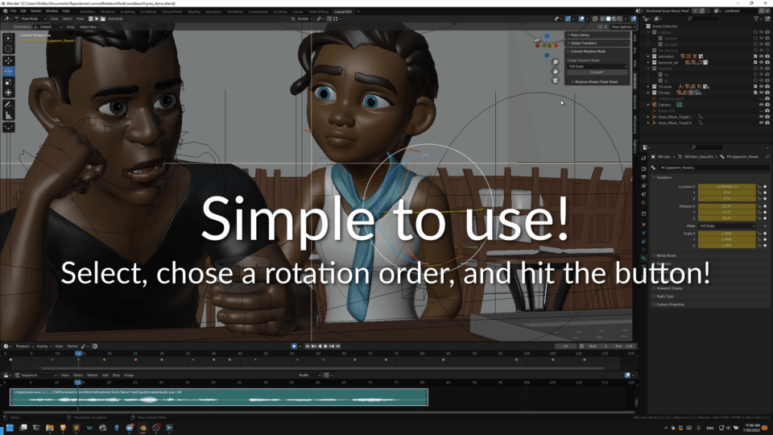
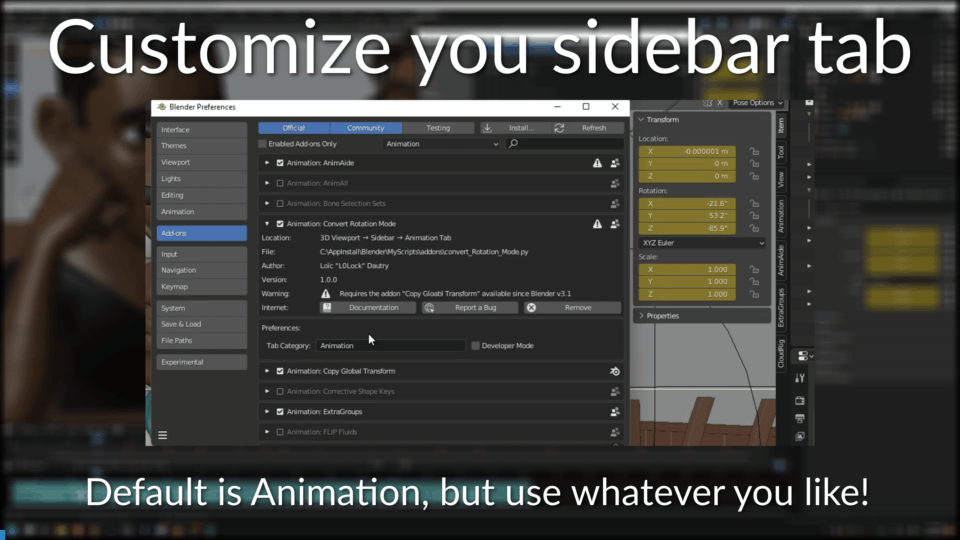
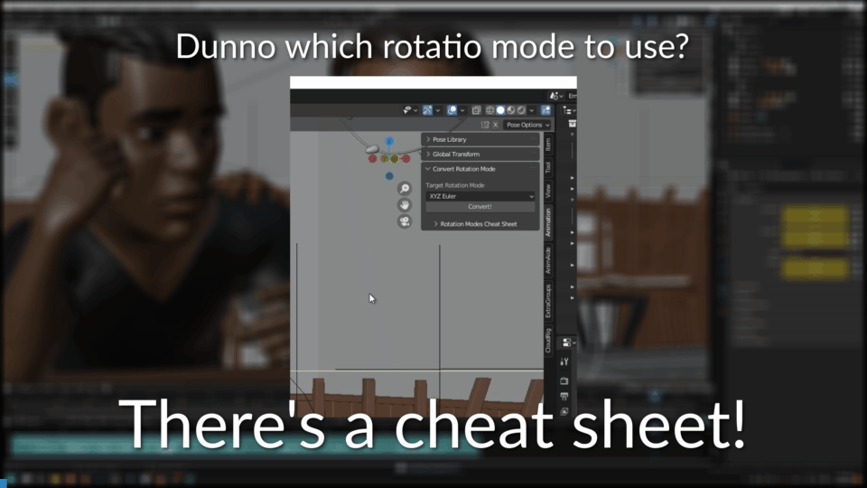

# Convert Rotation Mode

[)](https://github.com/L0Lock/convertRotationMode/blob/master/LICENSE) ) ) [](https://ko-fi.com/H2H818FHX)

-----

*Convert Rotation Mode* (*CRM*) is an addon for Blender that allows you to change the rotation mode of the selected bones and preserve the animation or poses you already made.

> [!IMPORTANT]
> **This addon is no longer developed: Blender 5.3 has a native equivalent.**
>
> *Convert Rotation Mode* is now in maintenance mode. It receives bug fixes only, for **Blender 4.5 LTS and 5.2 LTS**, until each reaches end of life (July 2027 and July 2028 respectively). It is not compatible with Blender 5.3 and newer, and the repository will be archived once both LTS versions are retired.

## Migrating to Blender 5.3

Blender 5.3 ships the `anim.rotation_mode_convert` operator, which converts animation between rotation modes while preserving the result. It works on all selected objects or bones, and is available from:

- *Object ‣ Animation*
- *Pose ‣ Animation*
- the dropdown next to the rotation mode property
- <kbd>Ctrl+R</kbd> in Pose Mode

See the [Blender 5.3 release notes](https://developer.blender.org/docs/release_notes/5.3/animation_rigging/) and the [manual](https://docs.blender.org/manual/en/5.3/scene_layout/object/editing/animation.html#convert-rotation-mode).


## Installation (Blender 4.5 to 5.2)

### Simple method:

- Go to Edit > Preferences > Get Extensions
- Search "Convert Rotation Mode"
- Hit the Install button

### Not so simple method:

- Download the [**latest release**](https://github.com/L0Lock/convertRotationMode/releases/latest).

- Go to Edit > Preferences > Get Extensions

- Hit the 🔽 button > Install from Disk

- Browse the zip file you downloaded.

## Usage



Select one or more bones in Pose mode, select the rotation mode you want them to use, hit the <kbd>Convert!</kbd> button.

It will automatically scan through all the keyframes of the selected bones in the timeline.



To customize the sidebar tab in which the addon appears, go to the addon's preferences.



If you are unsure what rotation mode to use, look at the rotation modes cheat sheet!

Please note these are merely suggestions, what you will actually need may vary from one rig to another or even from one animation to another.

Note that there are two main coordinates system for bones. Blender uses Y down, so this is most likely the one you will use. But you might need to look at the X down in some cases like exporting to softwares that can only read X down.

## Recommanded Rotation Modes:

| Bone/Body Part    | Rotation Mode |
| ----------------- | ------------- |
| COG               | zxy           |
| Hip               | zxy           |
| Leg Joints        | yzx           |
| Shoulder/Clavicle | yxz           |
| Upper Arm         | zyx (or yzx)  |
| Lower Arm         | zyx (or yzx)  |
| Wrist             | yzx           |
| Spine Base        | zxy           |
| Mid Spine         | yzx           |
| Chest             | zxy           |
| Neck              | yxz           |
| Head              | yxz           |

## Contributing

The addon is in maintenance mode: bug reports and fixes for the supported LTS versions are welcome, but new features are not accepted.

I recently started using [PyType](https://github.com/google/pytype) type-checker. While I'm not sure it's a big deal whether you use it, or another one, or none at all, it definitely helps avoid issues if we all use the same. Hence furnished the repo with its own [requirements.txt](https://github.com/L0Lock/convertRotationMode/blob/main/requirements.txt). 

To use it, create a virtual environment in your local repo ([see guide here, its a tad different for each operating system](https://www.geeksforgeeks.org/create-virtual-environment-using-venv-python/), then once created and activated, install the required packages using:

```bash
pip install -r requirements.txt
```

This way we are sure to be on the same base :] 
